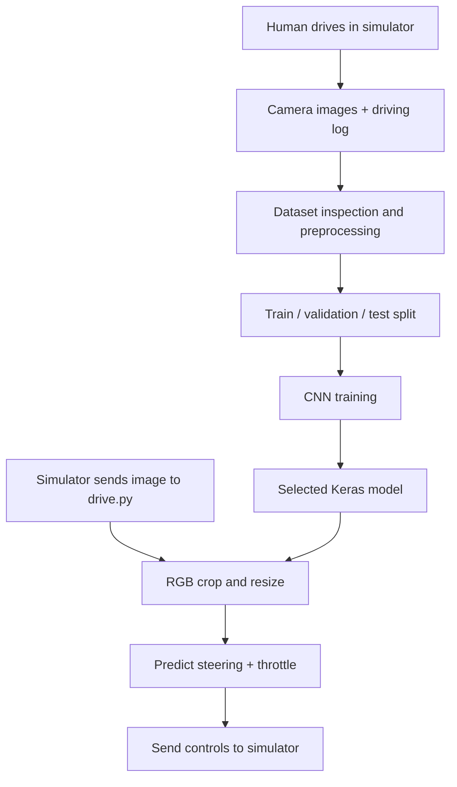
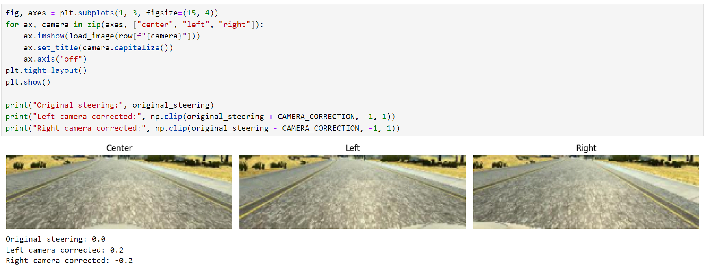
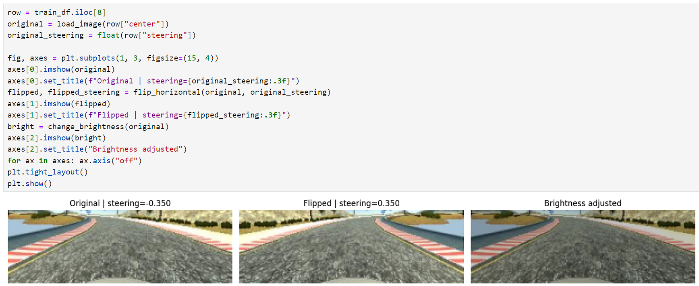
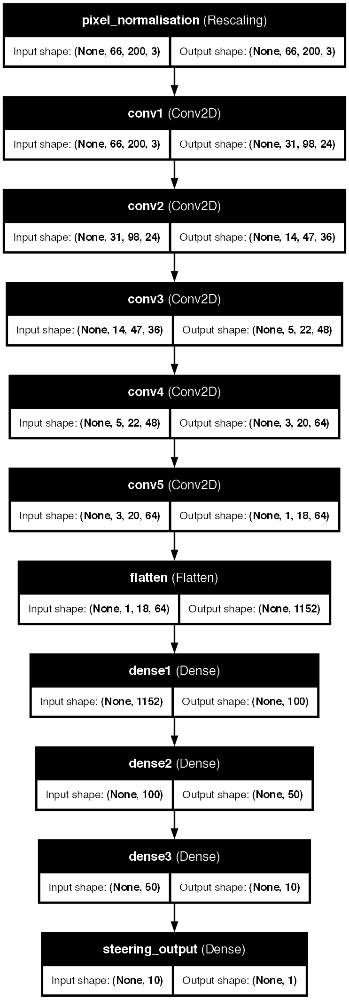
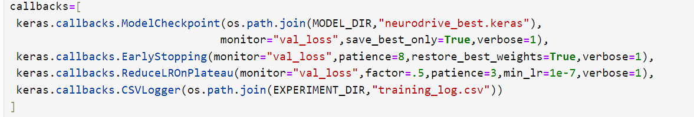
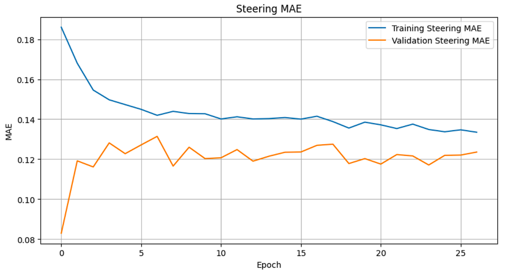
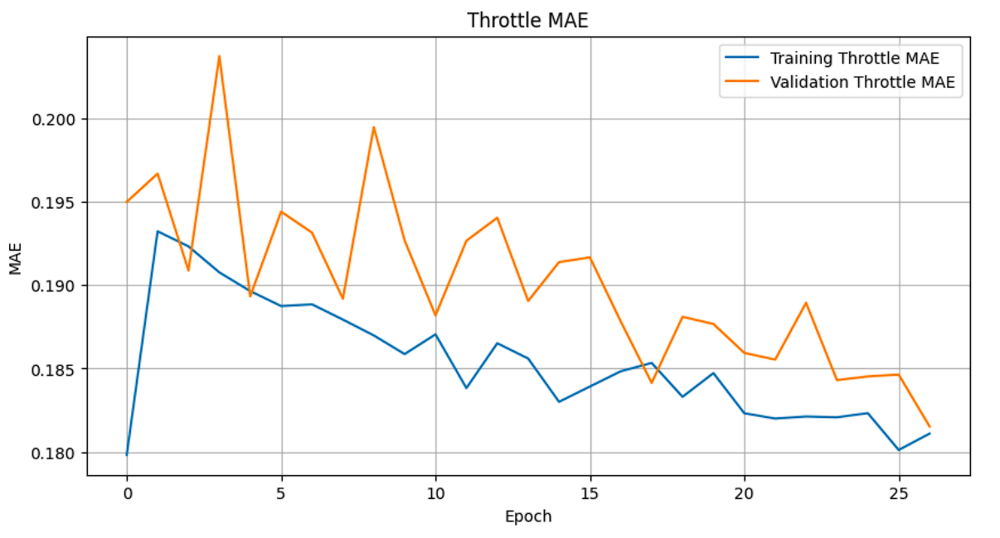

<div align="center">


<br>
<br>

[](https://www.python.org/)
[](https://www.tensorflow.org/)
[](https://keras.io/)
[](https://opencv.org/)
[](https://numpy.org/)
[]()
[](https://github.com/udacity/self-driving-car-sim)
[]()

<br>
</div>

NeuroDrive is a computer-vision project that learns driving behaviour from human demonstrations. A CNN takes a front-facing camera image and predicts **steering** and **throttle** commands.

**Selected model:** V8 · **Demonstration:** Udacity Simulator, Location 01


## How it works



`drive.py` runs a local Socket.IO server on port `4567`. It decodes each Base64 camera image, preprocesses it, predicts both controls and sends them back to the simulator.

## Data collection

Data was recorded by manually driving in the Udacity simulator. The simulator saves camera images and a `driving_log.csv` containing the corresponding image paths and control values.

Approximately **15,000 images** were collected across multiple attempts. Different driving patterns and collection rounds were needed because the early model versions did not achieve the desired driving behaviour.

### Three camera views



| CSV field | Description |
|---|---|
| `center`, `left`, `right` | Three camera image paths |
| `steering` | Steering command |
| `throttle` | Accelerator command |
| `brake` | Brake value |
| `speed` | Vehicle speed |

Training randomly selects centre, left or right images. Side-camera samples receive a steering correction (`+0.20` for left, `-0.20` for right). Validation and testing use centre-camera images.

## Preprocessing

The dataset is checked for missing values and missing image files, then split using seed `42`:

| Split | Data |
|---|---:|
| Training | 60% |
| Validation | 20% |
| Test | 20% |

Images are loaded with OpenCV (BGR), cropped by removing the top 35% and bottom 10%, resized to **200 × 66**, and converted to **RGB**. The resulting model input is `66 × 200 × 3`.

Training augmentation includes random camera selection, steering correction, horizontal flipping (with steering sign reversal) and brightness adjustment. Validation and test preprocessing is deterministic.



## CNN architecture

The network is inspired by NVIDIA's end-to-end driving CNN. It uses a shared convolutional feature extractor and two regression outputs.



## Training and experiments

V8 training configuration:

| Setting | Value |
|---|---|
| Framework / optimiser | TensorFlow / Adam |
| Learning rate | `0.0001` |
| Loss | MSE for both outputs |
| Batch size | `64` |
| Maximum epochs | `40` |
| Random seed | `42` |

ModelCheckpoint, EarlyStopping, ReduceLROnPlateau and CSVLogger are used during training. The saved V8 history contains **27 epochs**.



## Mean Absolute Error (MAE)

MAE measures the average absolute difference between the model's predicted controls and the actual recorded driving values.

### Steering MAE



### Throttle MAE



Lower MAE indicates predictions closer to the recorded driving behaviour.

## Run NeuroDrive Locally

### 1. Download the Udacity Simulator

Download the **Udacity Self-Driving Car Simulator (Beta)** for your operating system:

- [Windows / Linux / macOS – Simulator Releases](https://github.com/udacity/self-driving-car-sim)

Extract the downloaded archive and launch the simulator.

### 2. Clone the Repository

```bash
git clone https://github.com/abdulraheem05/Neuro-Drive.git
cd NeuroDrive
```

### 3. Install Dependencies

Install the required Python packages:

```bash
pip install -r requirements.txt
```

### 4. Launch Autonomous Driving

1. Open the Udacity Simulator.
2. Select **Location 01**.
3. Click **Autonomous Mode**.
4. Open a terminal in the NeuroDrive project directory.
5. Run:

```bash
python drive.py
```

The Python server loads the trained model and communicates with the simulator through Socket.IO on port `4567`. The vehicle should now drive autonomously using predicted steering and throttle commands.

> **Note:** Ensure the trained model is available in the `models/` directory before running `drive.py`.

### Reproducing Training

The raw driving dataset is not included. To train the model from scratch, collect your own simulator data using the Training Mode in Udacity and follow the notebooks provided in `notebooks/`.

## Limitations

- Demonstrated on simulator Location 01; other locations may behave differently.
- Performance depends on the driving patterns represented in the training data.
- Throttle is learned from demonstrations; it is not a closed-loop speed controller.
- Not tested or intended for real-world vehicle control.

## Acknowledgements

- [Udacity Self-Driving Car Simulator](https://github.com/udacity/self-driving-car-sim)
- [NVIDIA end-to-end learning for autonomous driving](https://images.nvidia.com/content/tegra/automotive/images/2016/solutions/pdf/end-to-end-dl-using-px.pdf)
